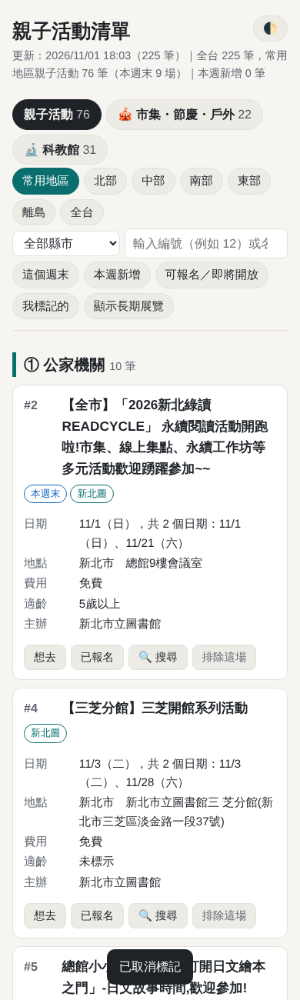
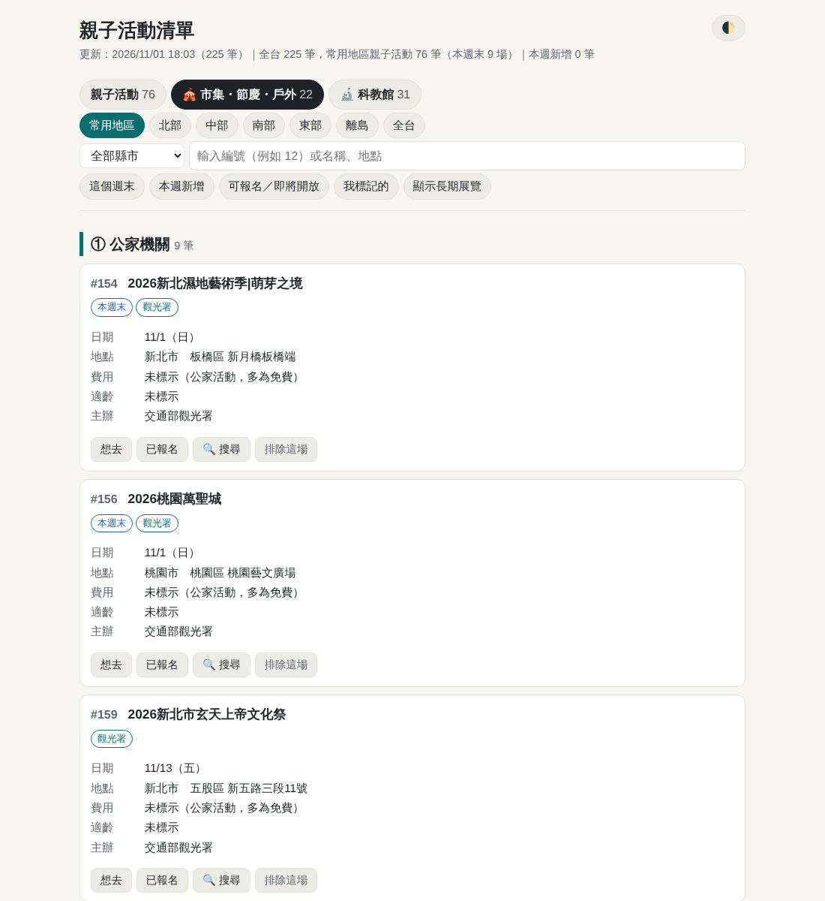
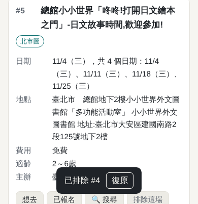
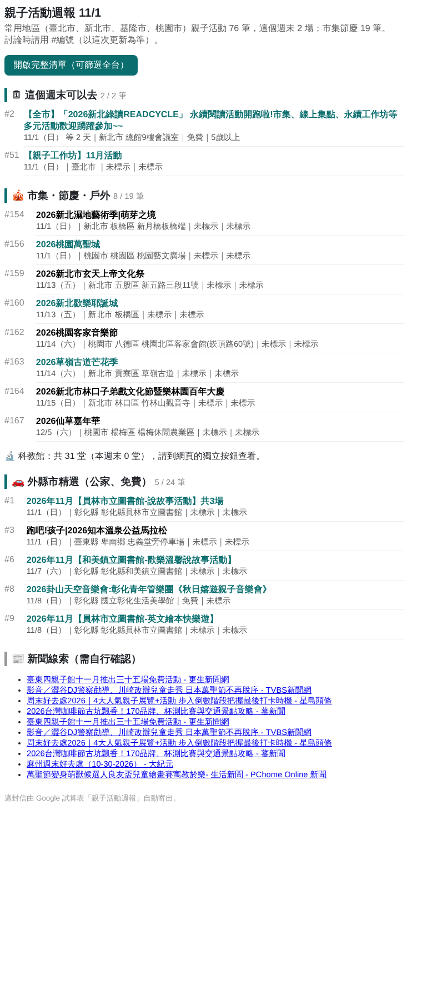

# 親子活動週報（Google 試算表＋Apps Script 版）

每週四 18:00 自動從網路收集適合 6～8 歲孩子的親子活動、市集與節慶，整理到 Google 試算表與手機網頁，並寄 Email 週報。
所有日常操作都在試算表的「親子活動」選單和「設定」分頁完成，不用改程式。

> 這是 GitHub 版的另一個版本，兩者各自獨立運作。GAS 版不含桃園市民卡、不含 LINE。

## 檔案

| 檔案 | 用途 |
|---|---|
| [`Code.gs`](Code.gs) | 主程式（約 1,400 行），貼到 Apps Script 的 `Code.gs` |
| [`Index.html`](Index.html) | 網頁，在 Apps Script 新增 HTML 檔，命名為 `Index` |
| `test/` | 開發用的模擬測試，不用貼 |

---

## 一、安裝（約 15 分鐘，只做一次）

### 1. 建立試算表與貼上程式
1. 開新的 Google 試算表（網址列輸入 `sheets.new`），命名為「親子活動週報」。
2. 上方選單「**擴充功能**」→「**Apps Script**」。
3. 左側齒輪「**專案設定**」→「時區」選 **(GMT+08:00) 台北**。
4. 回到左側「**編輯器**」（`< >` 圖示）：
   - 點 `程式碼.gs`（或 `Code.gs`），**全部刪除**，貼上 [`Code.gs`](Code.gs) 的內容。
     複製方法：在 GitHub 開啟檔案 → 右上角「Copy raw file」（兩個方框的圖示）。
   - 左上「檔案」旁的 **＋** →「**HTML**」→ 名稱輸入 `Index`（不用打 .html）→ 刪除預設內容 → 貼上 [`Index.html`](Index.html)。
   - 按 **儲存**（磁碟圖示或 Ctrl+S）。

### 2. 初始化
1. 回到試算表，按 **F5 重新整理**，上方會出現「**親子活動**」選單（約等 5 秒）。
2. 「親子活動」→「**① 初始化（建立分頁與欄位）**」。
3. 第一次會要求授權：「繼續」→ 選你的帳號 → 出現「Google 尚未驗證這個應用程式」→「**進階**」→「**前往 親子活動週報（不安全）**」→「**允許**」。
   這是你自己寫的程式，所以 Google 會這樣提示，屬正常現象。
4. 授權後再按一次「① 初始化」，會建立這些分頁：

   | 分頁 | 內容 |
   |---|---|
   | 活動清單 | 每次更新整表重寫；可篩選；「標記」欄可下拉選 想去／已報名／排除 |
   | 已排除 | 排除的活動與期間；把「狀態」清成空白＝恢復 |
   | 新聞線索 | Google 新聞找到的線索，保留 30 天 |
   | 設定 | 黃底欄位可以改（見下方） |
   | 執行紀錄 | 每個來源抓到幾筆、成功或失敗、寄信結果 |
   | 系統紀錄 | 隱藏，記錄首次發現日與標記，不用動 |

### 3. 填設定
到「**設定**」分頁，至少確認：
- **Email收件人**：家人的信箱，多個用逗號分隔。空白＝寄給自己（Gmail 自己寄給自己通常不跳通知，建議填另一個信箱）。
- **常用地區**：預設 臺北市、新北市、基隆市、桃園市。

### 4. 第一次更新
「親子活動」→「**立即更新清單（不寄信）**」→ 確認條件 → 按「是」，約 1～3 分鐘。
完成後看「**執行紀錄**」分頁，確認每個來源都是「成功」。

### 5. 部署網頁
1. Apps Script 右上「**部署**」→「**新增部署作業**」。
2. 左側齒輪「選取類型」→「**網頁應用程式**」。
3. 說明：`親子活動清單`；執行身分：**我**；具有存取權的使用者：**只有我自己**。
4. 按「部署」→ 複製「**網頁應用程式網址**」（`/exec` 結尾）。
5. 貼到試算表「設定」的「**網頁網址**」。手機開這個網址時，要用同一個 Google 帳號登入。

### 6. 啟用每週自動執行
「親子活動」→「**啟用每週自動執行**」→ 會顯示下次執行時間，例如「2026/11/05（四）18:00」。
之後每週四 18:00 自動更新並寄週報。

### 7. 測試寄信
「親子活動」→「**寄送測試信**」或「**只寄送週報（用目前清單）**」，確認家人收得到。

---

## 二、日常使用

| 想做的事 | 怎麼做 |
|---|---|
| 看活動 | 開網頁（手機可用），或看試算表「活動清單」 |
| 跟家人討論 | 用 **#編號**（例：#12）。編號每次更新重排，以同一次週報為準 |
| 標記想去／已報名 | 網頁按按鈕，或試算表「標記」欄下拉選。兩邊同步，下次更新會保留 |
| 排除這場 | 網頁按「排除這場」（6 秒內可按「復原」），或試算表「標記」選「排除」。**只排除這次的日期**，之後同名活動有新日期仍會出現 |
| 恢復已排除 | 網頁最下方「已排除的活動」→「恢復」，或試算表「已排除」把「狀態」清空 |
| 官方連結打不開 | 網頁按「🔍 搜尋」 |
| 改條件 | 改「設定」分頁黃底欄位，下次更新生效 |
| 改每週執行時間 | 改「每週執行星期」「每週執行時間」→ 選單「啟用每週自動執行」 |
| 馬上更新 | 選單「立即更新清單」或「立即更新並寄送週報」 |

### 選單一覽

| 選單項目 | 作用 |
|---|---|
| ① 初始化 | 建立／修復分頁與欄位；設定表已填的值會保留，新版本新增的設定項目會自動補上 |
| ② 確認目前設定 | 顯示所有條件與檢查警告（地區名稱、年齡、Email 格式…） |
| 立即更新清單（不寄信） | 先顯示條件確認 → 抓資料 → 寫入試算表 |
| 立即更新並寄送週報 | 同上，完成後寄信 |
| 只寄送週報 | 不重抓，用目前清單寄信 |
| 寄送測試信 | 確認寄信設定，顯示今日剩餘寄信額度 |
| 啟用／停止每週自動執行 | 建立或刪除排程 |
| 檢查目前狀態 | 排程、收件人、寄信額度、最近更新與寄信時間 |
| 開啟網頁清單 | 開啟「設定」裡的網頁網址 |
| 查看已排除的活動 | 切到「已排除」並說明恢復方式 |

---

## 三、畫面

**網頁（手機）**：上方三個分頁按鈕、地區與縣市篩選、搜尋框；每張卡片有想去／已報名／搜尋／排除。

**網頁（電腦，市集・節慶・戶外分頁）**

**排除後 6 秒內可復原**

**Email 週報**：這個週末、即將開放報名、本週新增（依等級）、市集節慶、科教館摘要、外縣市精選、新聞線索、抓取失敗提醒。

---

## 四、升級到新版程式

1. Apps Script 編輯器：把 `Code.gs`、`Index` 的內容整個換成新版 → 儲存。
2. 回試算表 F5 →「親子活動」→「① 初始化」（補上新設定項目，原本的值會保留）。
3. 網頁要更新：「部署」→「**管理部署作業**」→ 鉛筆圖示 →「版本」選「**新版本**」→「部署」。網址不會變。

---

## 五、資料來源

| 來源 | 範圍 | 方式 |
|---|---|---|
| 文化部藝文活動開放資料 | 全國 | JSON；親子類全收，其他分類需含兒童關鍵字 |
| 交通部觀光署 活動資料庫 | 全國 | ZIP 內 JSON；節慶、市集歸「市集・節慶・戶外」 |
| 臺北市立圖書館 兒童活動 | 臺北市 | RSS |
| 新北市立圖書館 活動資訊 | 新北市 | 列表前 3 頁＋詳細頁 |
| 國立臺灣科學教育館 | 臺北市 | 只收「報名中」；網頁獨立按鈕 |
| ACCUPASS 活動通 | 全國 | 搜尋「免費親子活動」「市集」等 7 組關鍵字 |
| 臺北花博公園 | 臺北市 | 首頁活動；自由入場的市集歸市集分頁 |
| 華山1914、松山文創園區 | 臺北市 | 展演列表 |
| Google 新聞 | — | 只當線索 |

## 六、限制與注意

- Apps Script 單次最多執行 6 分鐘；目前全部來源約 1～3 分鐘。
- 個人 Gmail 帳號每天可寄約 100 封信。
- 部分政府網站可能擋 Google 的伺服器；若「執行紀錄」某來源一直「失敗」，請告訴我。
- 價格、年齡、日期是從文字判斷，可能有誤差，報名前請點連結確認。
- 自動執行由 Google 排程，通常在設定時間的前後幾分鐘內執行。
